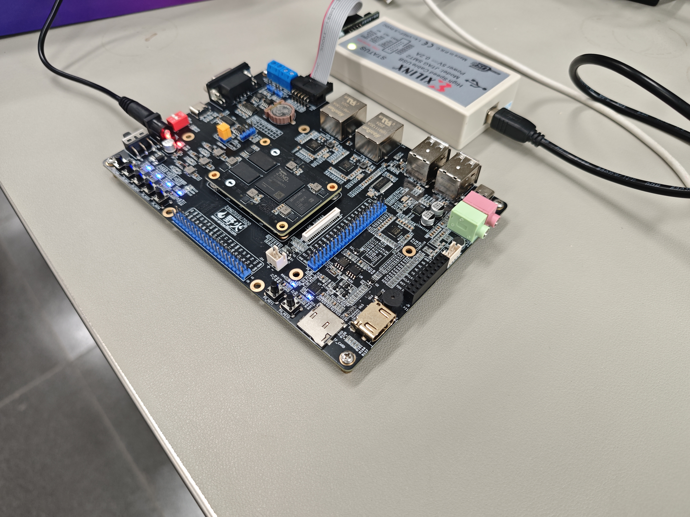

# Zynq-7020 fixed-point CNN handwritten digit recognition

基于 Zynq-7020 的定点 CNN 手写数字识别系统，2026 AMD FPGA 自主选题赛道工程公开版。当前发布基线为 V3，仓库整理日期为 2026-11-03。组别取决于实际队员学历，本仓库不代替组别资格审核。

## 评审入口

- [设计报告](report/design_report.md) 与 [原模板PDF初稿](report/design_report_draft.pdf)
- [要求对照表](report/submission_checklist.md)
- [可复用技能包](skill/README.md)
- [大模型协作记录节选](report/ai_collaboration.md)
- [工程包与完整数据下载](https://github.com/SuNu0/zynq7020-cnn-mnist-fpga2026/releases/tag/v3-submission-20261103)
- [实板输出](reports/physical_board_test.txt)、[RTL仿真输出](reports/v3_simulation.log)、[资源报告](output/utilization.rpt)、[时序报告](output/timing_summary.rpt)



## 功能与证据边界

浏览器画布提供单数字输入，电脑完成28×28图像预处理，通过JTAG/DDR邮箱将图像传至ARM裸机服务。PS调度AXI DMA，将784字节送入PL定点CNN，再把预测数字返回网页。正常识别不使用电脑模型代替FPGA分类，UART作为可选传输路径。

| 项目 | V3结果 | 证据口径 |
|---|---|---|
| 目标器件 | xc7z020clg400-2，皓月Zynq-7020 | 当前上板目标 |
| 工具 / 时钟 | Vivado/Vitis 2025.2，90MHz | 原工程版本 |
| 唯一训练底图 | 332,455 | MNIST与新增NIST，增强/回放不重复计数 |
| MNIST准确率 | 9,949/10,000，99.49% | Python定点参考 |
| 新NIST准确率 | 15,458/15,530，约99.54% | 自定义书写者隔离测试，非标准QMNIST成绩 |
| RTL用例 | 75组，105,600个池化值及750个分数 | 已保存2026-10-25原始仿真记录 |
| 实板样例 | 40/40正确且与参考一致 | 已保存历史板测日志，不是全量板端准确率 |
| 资源 | LUT 5,168，FF 3,385，BRAM Tile 2，DSP 2 | 整机布局布线后 |
| 时序 | WNS 1.038ns，WHS 0.046ns | 90MHz布局布线后 |
| 计算时延 | 约979,000周期，约10.9ms | 周期折算，非网页端到端实测 |

2026-11-03的仓库整理不包含新一次板测或布局布线。新执行的检查结果另见 `report/publication_validation.json`，不能替代原始硬件记录。

## 目录与指南推荐结构的对应

保留既有脚本兼容的组织方式，所有仓库路径使用英文。README.md、LICENSE等标准文件名沿用指南示例。中文只用于正文内容。

| 指南推荐目录 | 本仓库位置 |
|---|---|
| src/ | rtl/、software/、model/ |
| sim/ | tb/、scripts/run_v3_sim.tcl、reports/v3_simulation.log |
| build/ | scripts/create_project.tcl、scripts/build_hardware.tcl、output/中资源与时序报告；实际构建缓存build/忽略 |
| board/ | board/、scripts/program_jtag_mailbox.tcl、software/jtag_mailbox/、output/ |
| data/ | data/及Release数据包、tb/vectors/ |
| skill/ | skill/ |
| report/ | report/ |

## 从零复现

在Windows中解压完整工程包或克隆仓库。需要Python 3.13以及Vivado/Vitis 2025.2；Xilinx默认目录 `D:/Xilinx/2025.2`。位置不同时设置 `XILINX_XSCT` 和 `XILINX_VIVADO_BIN`，重新构建固件还可设置 `XILINX_ARM_GCC_DIR`，见 `scripts/build_firmware.py`。

### 1. 校验与网页依赖

```powershell
python skill/verify_manifest.py manifest/files.csv --root .
python -m venv .venv
.venv\Scripts\python -m pip install -r software/pc_web/requirements.txt
```

### 2. 直接使用已验证的BIT和ELF

连接开发板电源与JTAG，执行 `02_program_v3_board.cmd`，等待 `CNN_JTAG_MAILBOX_PROGRAMMED`。执行 `03_verify_v3_board.cmd` 进行40张标签样例测试，最后执行 `01_start_v3_web.cmd`，访问 http://127.0.0.1:5003 。断电后需重新下载。`05_view_training_images.cmd`可打开随包预览图。

### 3. 从源码仿真与构建

```powershell
powershell -File scripts/run_v3.ps1 -Action sim
powershell -File scripts/run_v3.ps1 -Action build
```

硬件构建脚本会在工程不存在时创建PS、DMA、互连和V3核心；固件构建根据XSA生成BSP，再编译两个ELF。源码仅显式加入实际V3 RTL，未使用的旧版V1电路不在公开包中。自带参考向量足以运行RTL仿真，不需先下载完整训练数据。

### 4. 数据、训练与完整精度评估

```powershell
.venv\Scripts\python scripts/fetch_data.py
.venv\Scripts\python -m pip install --extra-index-url https://download.pytorch.org/whl/cpu -r requirements_full.txt
.venv\Scripts\python scripts/prepare_v3_data.py
.venv\Scripts\python model/evaluate_v3.py
# 以下训练会覆盖模型和权重，先保留一份提交基线
.venv\Scripts\python model/train_v3.py --epochs 36
```

历史精确依赖版本见requirements_full.txt。训练从baseline_v2/model/cnn_v2.pt开始。重新训练后必须重新构建BIT再下载，不可只替换电脑上的模型文件。

## 发布范围与限制

原模板技术报告和中文PSD海报仍是初稿，含待补界面截图位置。照片已另收录在board/photos。演示视频、签字承诺书和决赛要求的一页英文PPT海报尚未包含；不能仅凭本仓库链接宣称全部比赛材料已齐备。报告与海报PDF的版本状态见要求对照表。

MIT用于本次原创公开代码与文档，第三方数据和AMD生成材料保留各自许可；见[第三方说明](third_party_notices.md)。未使用且许可不明的V1历史RTL不公开，也不改变原本地项目和私有仓库。
