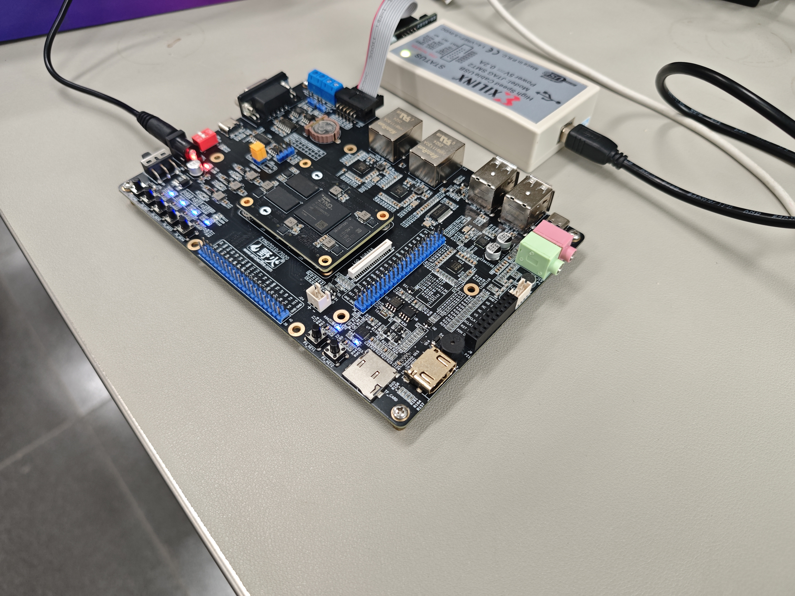
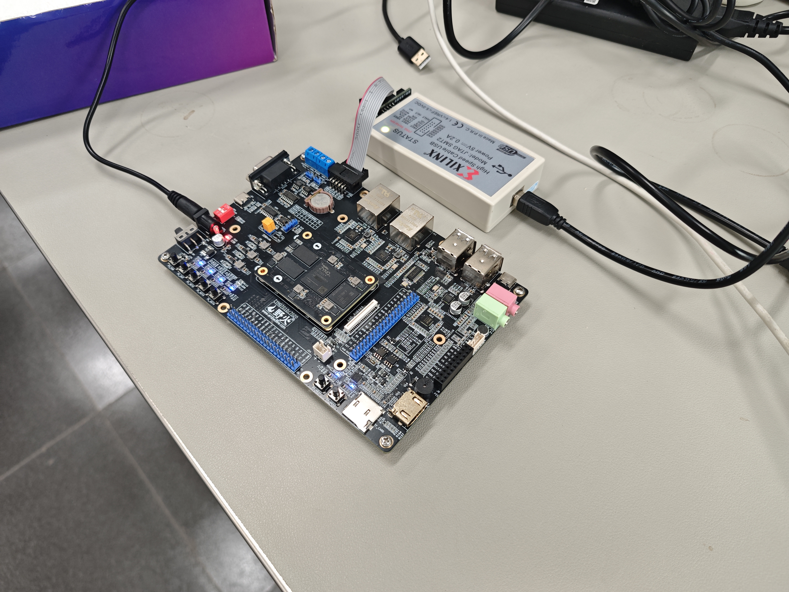

# V3设计报告与提交补充

本报告基于V3实际源码与2026-10-25验证记录。本文的构建、接口、协作及技能包部分为2026-11-03提交整理补充，不虚构新的板测或性能成绩。

## 软硬件划分依据

电脑承担画布交互、灰度与尺寸位置归一化，便于观察实际送板图像。PS承担邮箱协议、内存与AXI DMA调度，避免用PL实现非计算密集交互。PL承担重复乘加、池化和分类，采用时分复用乘法降低资源需求。AXI Stream以valid/ready约束接收和回传，定点参考与RTL共享权重排列、舍入和饱和规则。

## 优化前后对照

| 指标 | V2 | V3 | 解释 |
|---|---:|---:|---|
| 唯一训练底图 | 55,000 | 332,455 | 扩充真实NIST字迹，排除重叠来源与测试书写者 |
| MNIST定点参考准确率 | 99.14% | 99.49% | 同批10,000张测试图 |
| 新NIST独立书写者 | 约99.02% | 约99.54% | 同批15,530张自定义测试图 |
| 合成画布归一化 | 98.75% | 99.15% | 尺寸位置压力测试，非真实用户手写 |
| LUT | 5,038 | 5,168 | 常量权重映射变化，未宣称资源下降 |
| FF | 3,396 | 3,385 | 整机布局布线结果 |
| BRAM Tile / DSP | 2 / 2 | 2 / 2 | 运算复用架构保持 |
| 计算窗口 | 约10.9ms周期折算 | 约10.9ms周期折算 | 网络结构保持，无实测整机加速比结论 |

## 大模型协作与技能提炼

真实会话的相关脱敏节选、错误纠正与适用边界见[ai_collaboration.md](ai_collaboration.md)。预览文件被精简打包遗漏、模型成绩与板测成绩混淆风险、模板分页和路径约束，是本次沉淀[skill/](../skill/README.md)的观察来源。校验脚本可用于其他FPGA项目，不依赖本作品的CNN结构，也不冒充PYNQ专项Skill。

## 已有板卡实拍

实拍照片证明当前板卡外观与连接，不能单独证明准确率；数值证据仍以带标签输出和参考比对为准。原模板PDF/DOCX为可继续补图的初稿。

## 复现

完整从零步骤见根README。需要原始数据时下载固定Release的datasets.zip并核验，推理部署、RTL仿真所需权重与向量已在仓库。完整工程RAR同时提供全部数据，文件名和目录名已规范为英文。

---

基于Zynq7020的定点CNN
手写数字识别系统

摘要

本作品面向0—9单个手写数字识别，构建基于Zynq-7020的定点CNN系统。网页将手写输入归一化为28×28图像，经JTAG邮箱、PS裸机服务与AXI DMA送入PL完成分类，再返回结果。网络采用8/16通道卷积、16位Q12权重和48位累加，通过计算单元复用控制资源开销。V3使用332,455张真实底图训练，MNIST软件定点参考准确率为99.49%，自定义独立书写者NIST测试约99.54%。既有记录显示75组RTL用例通过、40张实板样例全部正确，90MHz布局布线时序满足。项目提供训练、量化、验证和部署资料，面向嵌入式智能教学与硬件推理演示。完整测试集成绩为软件参考，40张实板样例不代表全量板端准确率。

第一部分  作品概述

1.1  功能与特性

系统支持网页画布输入单个数字，显示实际送入FPGA的28×28灰度图，并返回板端预测结果。正常识别由PL中的CNN完成，电脑侧负责交互、预处理和传输。项目提供JTAG邮箱默认通路及UART可选通路，包含模型训练、定点导出、RTL自动检查、硬件构建、下载和40样例实板验证入口。断电后按脚本重新下载即可开展交互演示。

1.2  应用领域

作品面向嵌入式神经网络教学、FPGA定点运算验证与单数字输入演示。可用于理解训练模型如何映射为权重、存储和运算控制，观察图像预处理对分类的影响，并比较参考模型与硬件结果。当前适用清晰单数字输入，复杂背景照片、多数字定位、连续文本识别及安全关键业务不在本版验证范围。

1.3  主要技术特点

采用两层5×5卷积、ReLU与2×2最大池化，形成256维特征后进行十类全连接分类。权重为16位Q12，偏置32位，累加48位；卷积输出统一舍入并饱和至16位非负特征。RTL按状态机复用乘加流程，以AXI Stream握手支持间断输入和输出背压。PS通过AXI DMA连接内存与PL，网页展示预处理输入。训练、定点参考和部署权重具有一致的排列和数值规则，便于逐层核验。

1.4  主要性能指标

| 指标 | 结果 | 验证口径 |
| --- | --- | --- |
| 目标器件与频率 | xc7z020clg400-2，90MHz | V3构建 |
| MNIST准确率 | 99.49%，9,949/10,000 | Python定点参考 |
| 新增NIST准确率 | 约99.54%，15,458/15,530 | 自定义书写者隔离测试 |
| RTL / 实板用例 | 75组 / 40张全部通过 | 两类独立验证记录 |
| 实现资源 | 5,168 LUT，3,385 FF
2 BRAM Tile，2 DSP | 整机布局布线后 |
| 时序裕量 | WNS 1.038ns，WHS 0.046ns | 90MHz布局布线后 |
| 计算时延 | 约979,000周期，约10.9ms | 周期折算，非整机实测 |

表1 主要指标概览。不同验证层级分别报告，不以样例成绩替代全量实板评估。

1.5  主要创新点

（1）以统一定点规则连接训练导出、Python参考和RTL逐层检查，降低部署数值偏差。（2）以复用乘加与分层特征存储适配有限PL资源。（3）扩充真实字迹并按新增书写者隔离验证与测试，在同批测试集上比较V2/V3。以上为本作品工程设计特点，未据此主张首创算法。

1.6  设计流程

固定任务和数据划分，按验证集选模；导出定点权重；核对RTL逐层输出与接口；构建PS、DMA和CNN系统；生成配套BIT与ELF；下载验证样例，开展网页演示并归档报告。

第二部分  系统组成及功能说明

2.1  整体介绍

系统由电脑交互端、JTAG通信与DDR邮箱、PS裸机服务、AXI DMA和PL定点CNN组成。图1给出数据与结果的传递关系。电脑不执行正常识别中的分类，PS负责搬运和调度，PL输出预测数字。UART为保留的可选通信方式，当前默认使用JTAG邮箱。

图1 系统整体数据通路与模块关系

2.2  硬件系统介绍

2.2.1 硬件整体介绍

硬件使用皓月Zynq-7020开发板，目标器件xc7z020clg400-2。PS的M_AXI_GP0通过互连访问DMA控制寄存器，DMA的内存主接口经互连连接PS的S_AXI_HP0。输入和结果分别使用MM2S与S2MM方向，PL侧CNN通过8位AXI Stream接口接入。FCLK_CLK0提供90MHz时钟，proc_sys_reset与PS复位信号完成外设复位。

2.2.2 机械设计介绍

本版使用现成开发板和连接线，未设计专用外壳或机械执行机构，不涉及机械结构图。演示中保持开发板供电稳定、JTAG连接可靠，并避免线缆拉扯。板卡与连线实拍由团队另行补齐。

2.2.3 电路与计算模块介绍

系统不包含本项目自行设计的PCB。电路功能通过PS、AXI互连、DMA和自定义RTL完成，工程脚本为scripts/create_project.tcl，V3计算核心为rtl/axis_cnn_mnist_v3.v。卷积、池化和全连接结构见图2。

图2 CNN层次结构与张量尺寸

| 模块或信号 | 输入与输出 | 作用 |
| --- | --- | --- |
| 图像输入 | 784个8位像素 | 按行缓存28×28灰度图 |
| 卷积1与池化 | 1×28×28 → 8×12×12 | 5×5卷积，ReLU，2×2最大池化 |
| 卷积2与池化 | 8×12×12 → 16×4×4 | 多输入通道卷积与池化 |
| 全连接与最大值 | 256个特征 → 10类分数 → 预测数字 | 逐类累加并比较 |
| s_axis_tvalid / tready | 输入握手 | 握手成功时接收像素 |
| m_axis_tvalid / tready / tlast | 结果握手与帧结束 | 支持背压，结果有效时保持 |
| aresetn | 低有效复位 | 复位状态、计数及输出控制 |

权重为有符号16位Q12，偏置32位，累加48位。卷积层按与软件参考相同的加2048、算术右移12位及0—65535饱和规则产生特征。状态机复用乘法与累加过程，池化后分别保存1,152个和256个特征值。输入、输出握手和复位行为均在既有RTL测试中覆盖。

2.3  软件系统介绍

2.3.1 软件整体介绍

Flask提供网页，Pillow完成预处理。JTAG驱动借助XSCT写入DDR邮箱，ARM裸机服务启动DMA并等待PL输出，再将结果写回邮箱。网页地址为http://127.0.0.1:5003。当前流程依赖电脑与JTAG，适合交互演示。

2.3.2 软件各模块介绍

| 模块与入口 | 关键输入 | 关键输出或行为 |
| --- | --- | --- |
| software/pc_web/app.py | 网页图像 | 预处理图及板端分类响应 |
| software/jtag_mailbox/ | DDR邮箱请求 | DMA调度、预测结果与状态 |
| model/train_v3.py | 训练集、V2初始权重 | V3模型和六个部署mem |
| model/common.py | 图像、定点参数 | 整数分类分数及中间特征 |
| model/evaluate_v3.py | 固定测试划分 | 准确率、逐类结果、混淆矩阵 |
| scripts/run_v3.ps1 | program / sim / build等动作 | 运行、日志与PASS标记 |

训练底图由55,000张MNIST和277,455张新增NIST字迹组成，共332,455张，增强和回放未重复计数。新增数据源于QMNIST xNIST资料[1]，按来源及书写者隔离，排除原MNIST底图与测试书写者。新增验证和测试各覆盖独立137位书写者，属于自定义划分。

训练36轮，使用位置与形态增强，按验证集选择第29轮模型，测试集不参与选模。导出定点权重后核验mem与参数一致，再重新构建BIT。仅修改电脑侧模型和mem文件不会改变已下载的FPGA。

依次使用02_program_v3_board.cmd、03_verify_v3_board.cmd、01_start_v3_web.cmd。新机器先运行04_setup_web_runtime.cmd，训练依赖见requirements_full.txt。环境为Python 3.13、Vivado/Vitis 2025.2；工具路径调整见scripts/run_v3.ps1。

第三部分  完成情况及性能参数

3.1  整体介绍

V3已形成模型、RTL、固件、BIT/XSA、网页与验证记录。项目保存的实板日志覆盖数字0—9各4张，40张均正确且与参考一致。本次整理未重新接板，本文按既有记录报告结果。图3位置留作团队补充真实系统照片。

| 系统正面照片 待补 | 系统斜45°照片 待补 |
| --- | --- |
| 请替换为开发板、JTAG与电脑网页的真实连接照片。 | 请替换为能看清开发板接口和实际运行状态的照片。 |

图3 系统整体实拍预留位置。照片由团队提供，替换时保留与本版一致的运行状态。

3.2  工程成果

3.2.1 机械成果

本版无独立机械结构，使用开发板原有结构开展演示。

3.2.2 电路成果

已保存90MHz系统的BIT、XSA、PS初始化脚本及JTAG/UART两套ELF。资源与时序原始报告位于output目录，DRC原始警告保留，不能把时序满足理解为所有检查均无警告。开发板正反面与芯片接口近景照片待补。

3.2.3 软件成果

网页支持画布输入、实际送入PL的28×28图像预览和结果显示；脚本支持下载、运行与验证。页面截图需包含清晰的手写输入、预处理预览及识别结果，由团队使用本版工程实际运行后补充。

| 网页识别界面截图 待补 |
| --- |
| 在此插入实际运行截图。建议包含手写数字、28×28预处理图和板端返回结果，避免出现学校、指导教师及个人账户信息。 |

图4 网页界面截图预留位置。

3.3  特性成果

| 测试条件 | V2 | V3 | 口径 |
| --- | --- | --- | --- |
| 原始MNIST测试图 | 99.14%
9,914/10,000 | 99.49%
9,949/10,000 | Python定点参考 |
| 新增独立书写者NIST | 约99.02%
15,378/15,530 | 约99.54%
15,458/15,530 | 自定义划分，非标准QMNIST成绩 |
| 合成画布归一化 | 98.75%
1,975/2,000 | 99.15%
1,983/2,000 | 确定性位置尺寸压力测试 |
| MNIST经网页预处理 | 99.09%
9,909/10,000 | 99.45%
9,945/10,000 | Python预处理与定点参考 |

表2 同批测试图的软件定点参考结果，来源reports/accuracy_v3.json。

V3浮点MNIST准确率为99.50%，定点为99.49%，有1张分类不一致并已计入定点成绩。合成画布测试由MNIST尺寸位置变化构成，不等同于真实用户手写测试。

| 验证项目 | 结果 | 证据与边界 |
| --- | --- | --- |
| RTL一致性 | 75组通过 | 核对105,600个池化输出和750个分数，含输入间断、背压、连续帧及半帧复位 |
| 实板样例 | 40/40正确，40/40与参考一致 | reports/physical_board_test.txt；仅该批标签样例 |
| 布局布线资源 | LUT 5,168 / FF 3,385
BRAM Tile 2 / DSP 2 | output/utilization.rpt；整机统计 |
| 布局布线时序 | WNS 1.038ns / WHS 0.046ns | output/timing_summary.rpt；90MHz |
| 计算周期折算 | 约979,000周期 / 约10.9ms | 非实板计时，非网页响应延迟 |

表3 硬件相关验证。实板状态以physical_board_test.txt为准。

CPU/FPGA实测加速比、功耗、完整测试集板端准确率和长期稳定性仍待评估。网页响应包含预处理、XSCT与JTAG开销，不能按10.9ms折算整机实测帧率。

第四部分  总结

4.1  可扩展之处

后续可在不改变数值契约的前提下评估更多计算并行度，并实测资源、时延与功耗的变化；完善常驻通信服务，减少交互中的XSCT启动开销；补充多人真实手写、复杂输入和长时间运行测试；按实际部署需求增加SD卡或QSPI启动。摄像头采集、多数字检测及连续文本识别需要新增完整算法与测试链路，不能视为当前已有功能。

4.2  心得体会

本项目的技术实践说明，模型准确率、RTL一致性和实板功能需要分别验证。Python定点参考用于覆盖完整测试集，RTL逐层检查用于定位舍入、饱和和张量排列问题，实板样例用于确认下载、传输、DMA和PL计算链路实际运行。任何一层通过都不能替代其他层。

计算单元复用降低资源开销，同时使控制时序、缓存地址和握手行为成为实现重点。输入间断、背压和复位测试与普通数字测试同样必要。训练数据增加主要改善模型见过的字迹分布，并不要求把训练图片存入FPGA；板上保存的是部署权重。

工程交付还需保持模型、mem、BIT、ELF和协议版本匹配，并保存可重建脚本、原始报告与校验值。约10.9ms的周期折算只能描述相应计算窗口，交互响应还包含电脑预处理和JTAG通信。完整实测加速比、整机功耗和长时间稳定性仍需独立实验，后续报告应继续明确测量条件与适用边界。

第五部分  参考文献

[1] YADAV C, BOTTOU L. Cold Case The Lost MNIST Digits[C]//Advances in Neural Information Processing Systems 32. Curran Associates, Inc., 2019. https://arxiv.org/abs/1905.10498.

[2] FACEBOOK RESEARCH. QMNIST[EB/OL]. https://github.com/facebookresearch/qmnist. 随包数据来源与许可：data/qmnist/README.md、LICENSE.

[3] 项目组. CNN手写数字识别V3训练与定点参考程序[CP]. 2026-10-25. model/train_v3.py、model/common.py、model/evaluate_v3.py.

[4] 项目组. V3 RTL与Zynq系统构建程序[CP]. 2026-10-25. rtl/axis_cnn_mnist_v3.v、scripts/create_project.tcl、scripts/run_v3.ps1.

[5] 项目组. V3数据划分与性能验证记录[R]. 2026-10-25. reports/dataset_v3.json、accuracy_v3.json、physical_board_test.txt；output/manifest.json、timing_summary.rpt、utilization.rpt.
